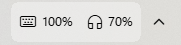

# BatteryBar

在 Windows 任务栏上显示无线设备的电量：耳机、鼠标、键盘、手柄、手机。




## 功能

- 任务栏小组件：设备图标与百分比，紧贴托盘区域，跟随任务栏明暗主题
- 托盘图标仅作为菜单入口，设备电量只在任务栏小组件中显示
- 圆角半透明底板，不透明度可配置（0–100%）
- 品牌配色（Razer 绿、Logitech 蓝等），可关闭改用单色
- 横向布局，或"图标在上、百分比在下"的紧凑布局
- 右键菜单内隐藏单个设备，方向键调整顺序，状态持久化
- 低电量提醒、充电状态；休眠设备与上次已知设备可隐藏
- 多显示器：仅主任务栏，或每块显示器各显示一份

## 支持的设备

电量通过以下三种通道读取：

| 方式 | 说明 |
| --- | --- |
| 标准 HID 电量 | HID 规范的 Battery Strength 用法，多数现代鼠标键盘具备 |
| 厂商私有协议 | 罗技 HID++、雷蛇、赛睿、HyperX、ROCCAT、AULA/MCHOSE、雷柏、漫步者…… 共 70 余个驱动 |
| 蓝牙电量属性 | 系统属性 `DEVPKEY_Bluetooth_Battery`，耳机、手机与蓝牙键鼠使用该通道 |

完整清单见 `src/core/drivers/`（每个文件对应一个厂商或协议）。接入新设备的方法见下文。

部分 2.4 GHz 接收器仅在厂商软件中暴露电量（如 Yichip 方案 `3151:3020` 接收器），
需先完成协议分析方可支持。

## 任务栏小组件

小组件实现为嵌入任务栏的透明子窗口，不遮挡任务栏内容，也不受"显示桌面"影响。

右键托盘图标 → 「任务栏文字背景（适用于透明任务栏）」：

- `无`：完全透明，只有图标和数字
- `10%` … `100%`：底板不透明度，默认 `60%`


## 安装

- **安装程序**：`dist\BatteryBar-Setup-<版本>.exe`（生成方法见 `packaging/README.md`）。安装向导可自选目标目录，
  默认 `%LOCALAPPDATA%\Programs\BatteryBar`；同时创建开始菜单快捷方式、登记到「应用和功能」、提供卸载项。
- **免安装**：`build\BatteryBar.exe` 可直接运行；
- **开机自启**：菜单项「开机启动」。

## 命令行

```
BatteryBar.exe --list      列出检测到的设备和电量
BatteryBar.exe --dump      把 HID 设备信息写到 %TEMP%\BatteryBar-dump.txt（提交 issue 时附上）
BatteryBar.exe --demo      以模拟设备预览小组件外观
BatteryBar.exe --quit      让正在运行的实例退出
```

## 从源码构建

构建入口是仓库根目录的 `Makefile`。
产物是静态链接的单文件，不需要额外的运行库。构建完成后可以自查：
```bash
build/BatteryBar.exe --list    # 列出检测到的设备与电量
```
单元测试的清单在 `tests/tests.txt`，逐条编译到 `build/tests/` 并依次运行：
```bash
make test
```

## 目录结构

```text
README.md                项目说明
LICENSE                  GPL-3.0
CONTRIBUTING.md          新增设备与提交规范
Makefile                 构建规则（GNU make）
screenshot.png           README 首图
src/
  main.cpp               入口：全局状态、窗口过程（WndProc）、wWinMain
  app/
    app_internal.h       模块间共享的全局变量与内部原型
    settings.*           注册表读写（含旧名字的设置迁移）
    tray.*               托盘图标与工具提示、设备条目、widget 数据
    menu.*               右键菜单与命令分发
    worker.*             后台轮询线程与刷新节流
    cli.*                命令行（--list / --dump）
    widget/
      widget.*           任务栏窗口的创建、定位、交互
      paint.cpp          纯绘制：字体、遮罩、圆角底板、布局
      widget_internal.h  绘制层与窗口层之间的访问器
  core/
    devices.*            设备轮询总入口
    hid.*                HID 枚举与读写封装
    dump.*               --dump 的附加信息
    drivers/             71 个厂商驱动，另有 drivers.h 框架
    drivers/protocol/    纯协议解析（5 个头文件 + 1 个实现，驱动与测试共用）
  text/
    i18n.*               翻译查找
    labels.*             短标签生成
    brands.*             品牌配色
resources/
  app.rc                 资源脚本（图标、清单、语言资源）
  app.ico                应用图标，由 make-icon.ps1 生成
  app.manifest           权限、DPI、通用控件版本
  make-icon.ps1          图标生成脚本
lang/
  _template.txt          键模板，新增短语先加到这里
  zh-CN.txt              简体中文
tests/
  *_test.cpp             24 个单元测试，用模拟的 HID 传输
  tests.txt              测试清单（name|额外源文件）
protocols/               设备私有协议笔记，不参与编译
packaging/               安装包脚本（Inno 版与免 Inno 的本地版）
build/                   构建产物，可删除（make clean）
```

## 新增一个设备

1. `src/core/drivers/` 下新建一个 `.cpp`，实现 `void PollSomething(PollContext& ctx)`；
2. 在 `src/core/drivers/drivers.h` 里声明；
3. 在 `src/core/devices.cpp` 的 `PollAllDevices()` 里调用（顺序有意义：先匹配的驱动会 `Claim` 该设备）；
4. 在 `tests/` 里加一个用模拟 HID 传输的测试；
5. 更新本文档；抓包与字节布局记到 `protocols/`（约定见 `protocols/README.md`）。

驱动守则：**只读**、精确匹配（只跟确认为该设备的厂商集合通信）、每个集合必须有超时（≤4 秒）、
注明协议来源。细节见 `CONTRIBUTING.md`。


## 许可

BatteryBar 是 [Wireless Battery](https://github.com/krisgfx9/Wireless-Device-Battery-Monitor) 的分支,仅做学习目的

GPL-3.0，见 `LICENSE`。
