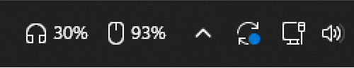

# BatteryBar

在 Windows 任务栏上显示无线设备的电量：耳机、鼠标、键盘、手柄、手机。



BatteryBar 是 [Wireless Battery](https://github.com/krisgfx9/Wireless-Device-Battery-Monitor) 的分支，
相对上游的差异：仅保留简体中文，移除联网上报与 Xbox 支持，重新划分目录，构建脚本适配新的目录结构。

## 功能

- 任务栏小组件：设备图标与百分比，紧贴托盘区域，跟随任务栏明暗主题
- 托盘图标仅作为菜单入口，设备电量只在任务栏小组件中显示
- 圆角半透明底板，不透明度可配置（0–100%）
- 品牌配色（Razer 绿、Logitech 蓝等），可关闭改用单色
- 横向布局，或"图标在上、百分比在下"的紧凑布局
- 右键菜单内隐藏单个设备，方向键调整顺序，状态持久化
- 低电量提醒、充电状态；休眠设备与上次已知设备可隐藏
- 多显示器：仅主任务栏，或每块显示器各显示一份

## 支持的设备

电量通过以下三种通道读取：

| 方式 | 说明 |
| --- | --- |
| 标准 HID 电量 | HID 规范的 Battery Strength 用法，多数现代鼠标键盘具备 |
| 厂商私有协议 | 罗技 HID++、雷蛇、赛睿、HyperX、ROCCAT、AULA/MCHOSE、雷柏、漫步者…… 共 70 余个驱动 |
| 蓝牙电量属性 | 系统属性 `DEVPKEY_Bluetooth_Battery`，耳机、手机与蓝牙键鼠使用该通道 |

完整清单见 `src/core/drivers/`（每个文件对应一个厂商或协议）。接入新设备的方法见下文。

部分 2.4 GHz 接收器仅在厂商软件中暴露电量（如 Yichip 方案 `3151:3020` 接收器），
需先完成协议分析方可支持。

## 任务栏小组件

小组件实现为嵌入任务栏的透明子窗口（`WS_EX_LAYERED` + `UpdateLayeredWindow`），
不遮挡任务栏内容，也不受"显示桌面"影响。

右键托盘图标 → 「任务栏文字背景（适用于透明任务栏）」：

- `无`：完全透明，只有图标和数字
- `10%` … `100%`：底板不透明度，默认 `60%`

约束：小组件必须由与任务栏相同完整性级别的进程创建。若程序由低完整性级别的父进程
（部分启动器、脚本宿主）启动，系统会拒绝创建该子窗口与托盘图标，此时程序提示一次并退出。
从开始菜单或资源管理器中直接启动即可满足条件。

## 安装

- **安装程序**：`dist\BatteryBar-Setup-<版本>.exe`（生成方法见 `installer/README.md`）。安装向导可自选目标目录，
  默认 `%LOCALAPPDATA%\Programs\BatteryBar`；同时创建开始菜单快捷方式、登记到「应用和功能」、提供卸载项。
- **免安装**：`build\BatteryBar.exe` 可直接运行；蓝牙耳机额外需要同目录的 `headsetcontrol.exe`。
- **开机自启**：菜单项「开机启动」。

## 命令行

```
BatteryBar.exe --list      列出检测到的设备和电量
BatteryBar.exe --dump      把 HID 设备信息写到 %TEMP%\BatteryBar-dump.txt（提交 issue 时附上）
BatteryBar.exe --demo      以模拟设备预览小组件外观
BatteryBar.exe --quit      让正在运行的实例退出
```

## 从源码构建

需要 **MSYS2 的 mingw-w64 工具链**（`g++`、`windres`、`make`），在 MSYS2 终端里装一次：

```bash
pacman -S --needed mingw-w64-x86_64-gcc make
```

构建入口是仓库根目录的 `Makefile`，在 **MSYS2 MINGW64** 终端里执行（开始菜单里的 `MSYS2 MINGW64`，
`g++`、`windres`、`make` 都在它的 PATH 里）：

```bash
cd /d/a_downloads/Repositories/BatteryBar
make          # 增量编译，产物 build/BatteryBar.exe
make clean    # 删掉 build/
```

规则是逐个 `.cpp` 编译成 `build/` 下同名 `.o`，再链接成 `build/BatteryBar.exe`；按时间戳跳过已是最新的文件，
改了头文件会重编所有依赖它的源文件。`res/app.rc` 由 `windres` 编成 `build/app_res.o`，`lang/*.txt` 合并成
`build/languages.txt` 后作为资源嵌入。`src/` 下的源文件是递归收集的，新增驱动不需要改构建文件。

不在 MSYS2 终端里时，可以在任意 PowerShell 里这样调用：

```powershell
D:\MSYS2\usr\bin\bash.exe -lc "cd /d/a_downloads/Repositories/BatteryBar && make"
```

单元测试清单在 `tests/tests.txt`：

```bash
make test
```

## 目录结构

```
src/
  main.cpp              入口：全局状态、窗口过程（WndProc）、wWinMain
  app/
    app_internal.h      模块间共享的全局变量与内部原型
    settings.*          注册表读写（含旧名字的设置迁移）
    tray.*              托盘图标与工具提示、设备条目、widget 数据
    menu.*              右键菜单与命令分发
    worker.*            后台轮询线程与刷新节流
    cli.*               命令行（--list / --dump）
    widget/
      widget.cpp        任务栏窗口的创建、定位、交互
      paint.cpp         纯绘制：字体、遮罩、圆角底板、布局
      widget_internal.h 绘制层与窗口层之间的访问器
  core/
    devices.*           设备轮询总入口
    hid.*               HID 枚举与读写封装
    dump.*              --dump 的附加信息
    drivers/            厂商驱动（+ drivers.h 框架，protocol/ 里是纯协议头）
  text/
    i18n.*              翻译查找
    labels.*            短标签生成
    brands.*            品牌配色
res/                    图标、清单、资源脚本
lang/                   UTF-8 翻译文件（`English = 中文`）
tools/                  图标生成脚本
tests/                  驱动单元测试（模拟 HID 传输）
docs/img/               截图
docs/drivers/           驱动协议笔记
installer/              安装包脚本（Inno 版 / 免 Inno 的本地版）
Makefile                构建规则（MSYS2 MINGW64 里 make）
Makefile                同一套构建的 make 版本
```

## 新增一个设备

1. `src/core/drivers/` 下新建一个 `.cpp`，实现 `void PollSomething(PollContext& ctx)`；
2. 在 `src/core/drivers/drivers.h` 里声明；
3. 在 `src/core/devices.cpp` 的 `PollAllDevices()` 里调用（顺序有意义：先匹配的驱动会 `Claim` 该设备）；
4. 在 `tests/` 里加一个用模拟 HID 传输的测试；
5. 更新本文档；抓包与字节布局记到 `docs/drivers/`（约定见 `docs/README.md`）。

驱动守则：**只读**、精确匹配（只跟确认为该设备的厂商集合通信）、每个集合必须有超时（≤4 秒）、
注明协议来源。细节见 `CONTRIBUTING.md`。


## 许可

GPL-3.0，见 `LICENSE`。
